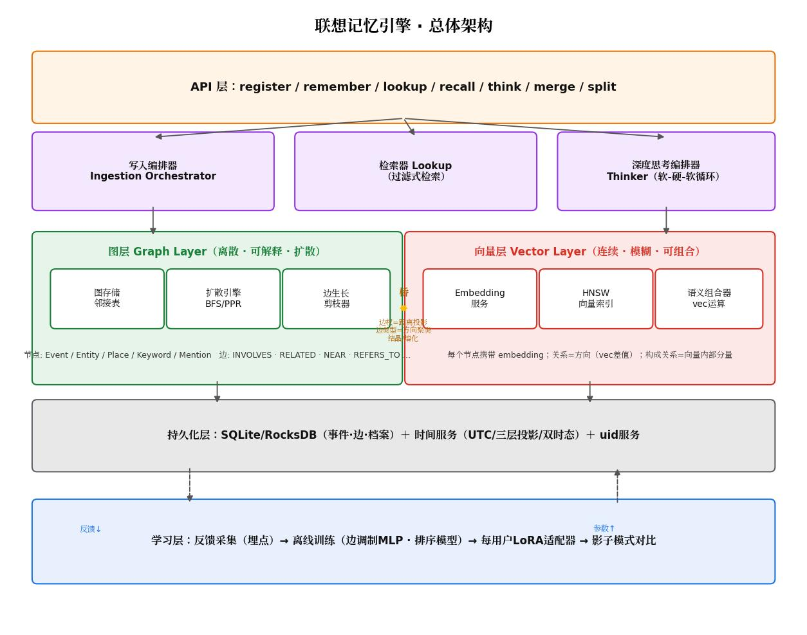
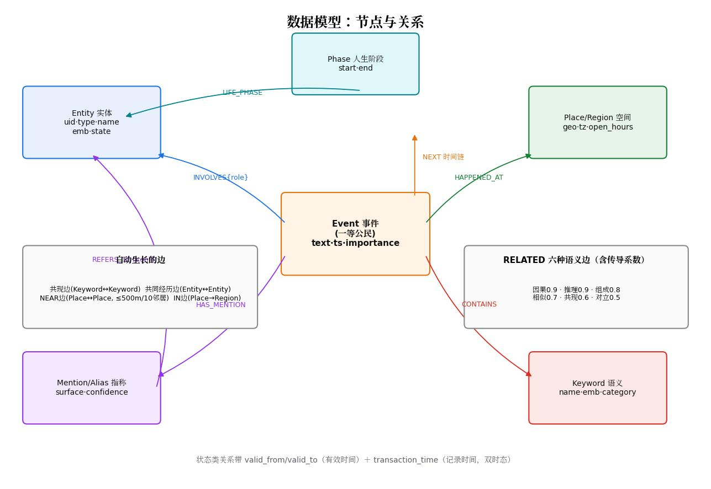
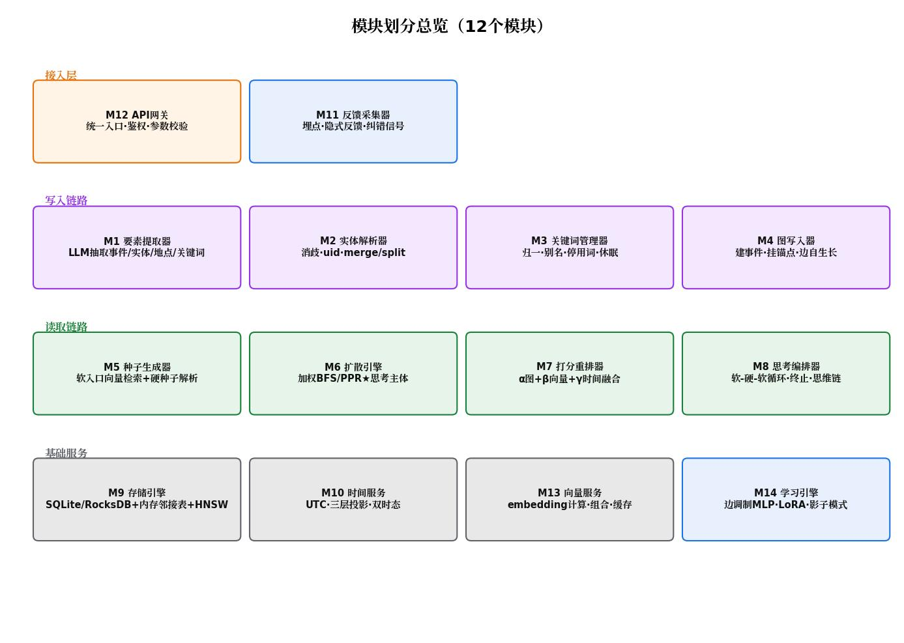
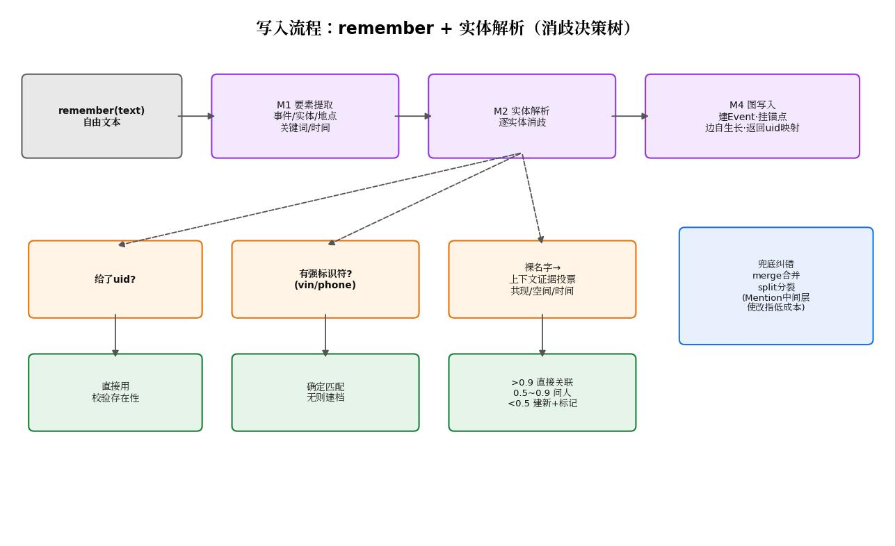
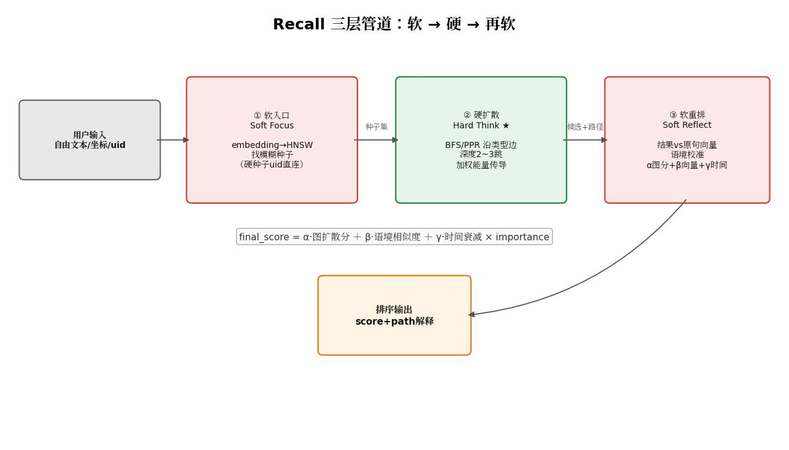
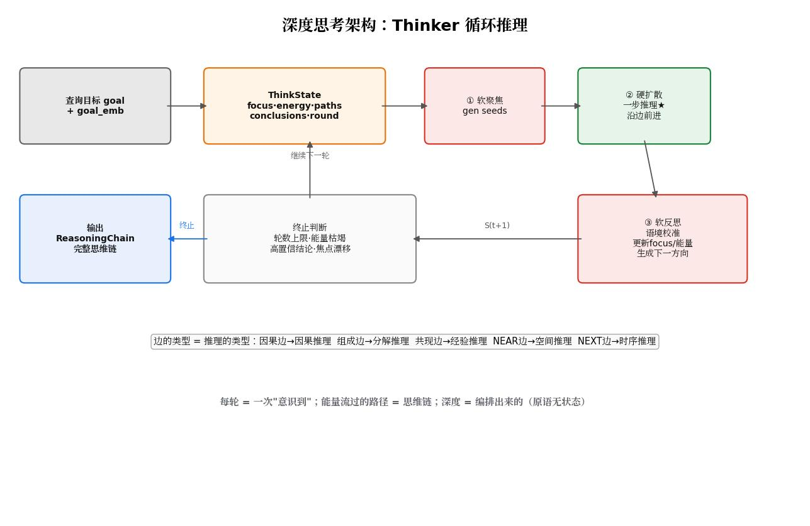
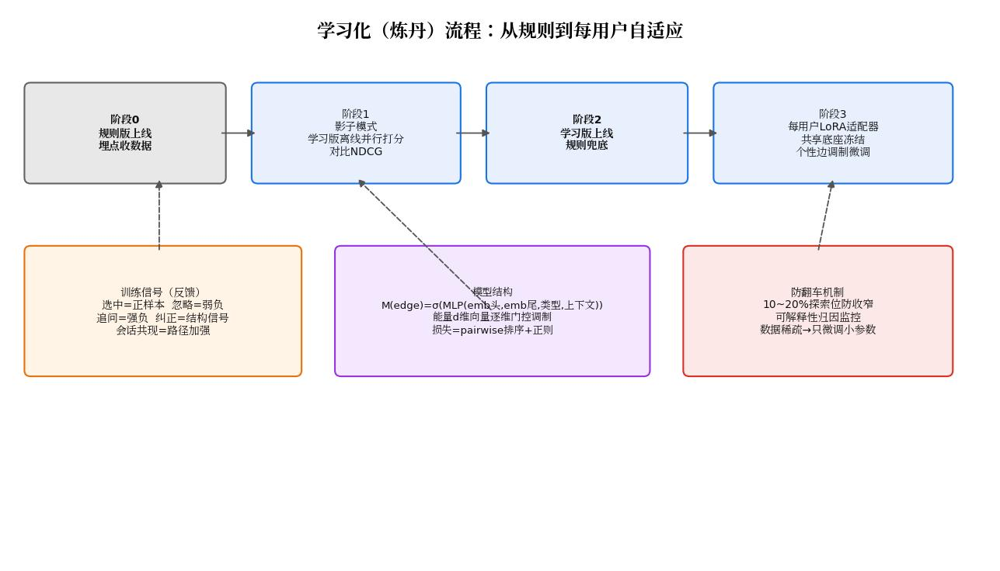

# 联想记忆引擎 · 完整设计文档

> 版本：v1.0 ｜ 状态：设计冻结，待原型验证
>
> **3.0 修订说明（dev-3.0）**：本文是 1.x 设计冻结原文，现行代码以
> [README"3.0 简化版"](../../README.md) 为准。其中 **M8 思考编排器（§M8、§6.3）、
> M11 反馈采集器、M14 学习引擎（§M11/§M14、第七节学习化方案）已在 3.0 裁剪**，
> 相关小节就地标注"[3.0 已裁]"，保留原文供设计溯源；其余 M1–M10/M12/M13
> 共 12 个模块为现行架构。架构图 04_深度思考 / 05_模块划分 / 07_学习化流程
> 中含被裁模块，属历史图稿未重绘。2.0 分层存储设计（AME2.0_分层记忆架构设计.md）
> 亦已裁撤归档，实现留存 dev-2.0 分支。
>
> **一句话定义**：一个以事件为核心、以"语义-实体-空间-时间"为锚点、由"向量层+图层"双骨架支撑、通过"软→硬→软"循环实现联想检索与深度思考的嵌入式记忆系统。

---

## 目录

1. [设计哲学](#一设计哲学)
2. [总体架构](#二总体架构)
3. [数据模型](#三数据模型)
4. [时间模型](#四时间模型)
5. [模块划分与接口定义](#五模块划分与接口定义)
6. [核心流程](#六核心流程)
7. [学习化方案（炼丹）](#七学习化方案)
8. [工程规范](#八工程规范)
9. [路线图与风险](#九路线图与风险)

---

## 一、设计哲学

三层递进的核心理念：

1. **万物皆是记忆的载体**：人、车、石头、空间在模型中无区别，都是事件的锚点。实体的"记忆"= 其参与过的事件集合；实体密度差异（IoT 设备日数百条 vs 静物十年一条）通过摘要聚合与"状态延续"机制处理。
2. **记忆不是存储的东西，是关联的网络**：回忆 = 从锚点出发沿关联做加权扩散。关联越用越强（赫布学习），长期不用衰减剪枝。
3. **名字是指称，语义是几何**：符号通过 REFERS_TO 边指向本体（uid 与名字彻底分离）；语义是向量空间中的点，语义间关系是空间中的方向。

### 语义之间的两种基本关系

判据：**删掉一个，另一个还完整吗？**

| | 构成关系（内涵） | 关联关系（外延） |
|---|---|---|
| 含义 | A 是 B 向量的组成成分 | A、B 独立存在但彼此相关 |
| 存在位置 | 向量层内部（方向分量，无限可分） | 图层（带类型的边，可增删） |
| 例子 | "睡眠"∈"失眠"的构成 | 失眠 ─因果→ 焦虑 |
| 数学形态 | vec(B) 在 A 方向上的分量 | edge_vec = emb(B) − emb(A) |
| 回答的问题 | "这个语义是什么" | "这个语义和什么有关" |

两种关系通过**桥**互相转化：构成关系被反复提及 → **结晶**为图层的"组成"边；关联关系高频使用 → **熔化**进向量（图嵌入拉近端点）。

---

## 二、总体架构



### 2.1 两层骨架

| | 图层 Graph Layer | 向量层 Vector Layer |
|---|---|---|
| 本质 | 拓扑：节点、边、路径 | 几何：点、距离、方向 |
| 语义形态 | 语义=节点，关联关系=带类型边 | 语义=点，构成关系=内部分量，关系=方向 |
| 擅长 | 精确关联、多跳推理、路径可解释 | 模糊匹配、开放表达、现场组合（vec(红色)⊕vec(店)） |
| 弱点 | 词表封闭、接不住没见过的说法 | 不可解释、距离近≠关系明确（反义词很近） |
| 类比 | 逻辑 | 直觉 |
| 不可替代性 | 能给出"因为A→B→C"的推理路径 | 能接住 99% 不在词表里的自然语言 |

### 2.2 桥（双向翻译，系统核心资产）

| 方向 | 机制 | 用途 |
|---|---|---|
| 向量→图 | 边权 = cosine 距离投影 | 图上标量 weight 是向量几何的快照 |
| 向量→图 | 边类型 = 全库 edge_vec 聚类 | 关系类型可从数据中自动发现（不必人工定死六种） |
| 向量→图 | 成分反复被提及 → 结晶 | 图层从向量层自动生长 |
| 图→向量 | 图嵌入反哺（node2vec/TransE 思路） | embedding 携带用户记忆结构，"咖啡馆"与"老张"在此人空间中更近 |
| 图→向量 | 关联熔化 | 高频绑定关系的节点向量逐渐共享分量 |
| 运行时 | 软入口 ANN → 硬扩散 → 软重排 | 见 Recall 管道 |

### 2.3 四类锚点与一层时间

- **四类锚点**：实体（Entity）、空间（Place/Region）、语义（Keyword）、时间（Phase/时间链）——挂在双骨架上，不是第三层。
- **指称层**：Mention/Alias 是"语言世界→语义世界"的唯一入口边，单独建模，不并入 RELATED 六类。
- **时间**：不构成层，作为节点与边上的约束维度（衰减、区间、阶段投影）。

---

## 三、数据模型



### 3.1 节点定义

| 节点 | 角色 | 字段 | 说明 |
|---|---|---|---|
| **Event** | 一等公民：发生的事 | id, text, timestamp(UTC), precision(year/month/day/second), importance, embedding, type | 唯一携带绝对时间的节点 |
| **Entity** | 锚点：人/车/物/组织 | uid（永久短随机码）, type, name, state(缓存), embedding, identifiers(强标识) | uid 与名字彻底分离 |
| **Place / Region** | 锚点：空间 | name, location, geohash, timezone, open_hours, embedding | 层级两级起步 |
| **Keyword** | 锚点：语义（非实体） | name(标准词), category, embedding, status(active/休眠) | 只接非实体语义 |
| **Mention** | 指称：文本中的一次出现 | surface, context | 事件不直指实体，经 Mention 中转 |
| **Alias** | 指称：别名/昵称/标准词变体 | surface | 指向 Entity 或 Keyword |
| **Phase** | 人生阶段 | name, start, end | 边界可模糊，过渡期事件可属多阶段 |

### 3.2 关系定义

**事件骨架**（手动/提取建立）：

```
(Event)-[:INVOLVES {role:主体|人物|客体}]->(Entity)
(Event)-[:HAPPENED_AT]->(Place)
(Event)-[:CONTAINS]->(Keyword)
(Event)-[:NEXT]->(Event)                    叙事时间链
```

**指称关系**：

```
(Mention)-[:REFERS_TO {confidence}]->(Entity)
(Alias)-[:ALIAS_OF]->(Entity | Keyword)
```

**空间关系**（自动建立）：

```
(Place)-[:IN]->(Region)                     按 geohash 前缀自动挂载
(Place)-[:NEAR]-(Place)                     ≤500m 自动互连，每点限近10邻居
```

**语义关系 RELATED 六类**（含默认传导系数）：

| type | 含义 | 例子 | 来源 | 系数 |
|---|---|---|---|---|
| 因果 | A 导致 B | 压力→失眠 | LLM/ConceptNet | 0.9 |
| 推理 | A 蕴含 B | 轮胎磨损→该保养 | 规则/LLM | 0.9 |
| 组成 | A 是 B 的部分/子类 | 爆胎∈行车故障 | 知识库/结晶 | 0.8 |
| 相似 | 近义（有程度） | 失眠≈焦虑 w=0.75 | 向量+共现取强 | 0.7 |
| 共现 | 经验中一起出现 | 咖啡↔失眠 | 统计自生长 | 0.6 |
| 对立 | 反义对照 | 踩坑↔值得 | 自动 | 0.5 |

> **对立必须单列**：向量空间中反义词距离很近，不单独切出会被扩散当作强联想。

**实体关系**：

```
(Entity)-[:EXPERIENCED_TOGETHER {count}]-(Entity)      共同经历，自生长
(Entity)-[:OWNED_BY {valid_from, valid_to}]->(Entity)  带有效期的状态关系
(Entity)-[:LIFE_PHASE {start, end}]->(Phase)
```

### 3.3 关键词体系

六类关键词（实体词不重复建，走实体锚点投影）：

| 类别 | 例子 | 管控 |
|---|---|---|
| 动作/事件类型 | 爆胎、维修、聚餐 | 受控词表 200~500，同义词归一 |
| 属性/状态 | 红色、二手、坏了 | 开放 |
| 主题/领域 | 工作、健康、理财 | 受控 20~50 根主题，LLM 强制归类 |
| 情感/评价 | 开心、踩坑、值得 | 开放（差异化能力，人类以情绪索引记忆） |
| 抽象概念 | 压力、拖延、性价比 | 开放，LLM 升华提取 |
| 实体投影 | 张三、朝阳公园 | 不建 Keyword，直接 INVOLVES/HAPPENED_AT |

管理四规则：**别名归一**（睡不着/失眠症→失眠）、**停用词黑名单**、**低频休眠**（出现<3次且无边连接不参与扩散）、**主题受控**。

### 3.4 自动生长机制（写入即执行）

1. 同一事件内关键词两两建/加共现边（weight+1）
2. 同一事件内实体两两建/加共同经历边（count+1）
3. 新 Place 自动挂 IN 边、计算 NEAR 边
4. 新事件推导标签：当地时间、场所时段（深夜/打烊后）、所属人生阶段
5. 成分语义被提及 ≥3 次 → 结晶为组成边
6. 长期未命中边权重衰减，低于阈值剪枝（赫布学习）

---

## 四、时间模型

**唯一事实源：Event.timestamp（UTC）**。其余时间皆为投影：

```
事件时间戳 ─┬─ × Place.timezone/open_hours → 空间的时间（当地时间/饭点/打烊后）
           ├─ × Entity.LIFE_PHASE          → 人的时间（人生阶段："大学那会儿"）
           └─ × NEXT 时间链                 → 叙事顺序（"后来""紧接着"）
```

规范：

1. 所有 timestamp 存 UTC，local_time 只推导不存储（防时区/夏令时坑）
2. Event.precision 标记时间粒度，模糊记忆（"那年夏天"）不强行精确
3. 状态类关系带 valid_from/valid_to（有效时间）；记忆修正叠加 transaction_time（双时态，旧记录不覆盖——"记错了又改"是可追溯的）
4. 实体"当前状态"= 最近事件投影，state 字段仅为缓存
5. 扩散打分的时间衰减用绝对时间；人生阶段/场所时段仅作筛选与分组维度

---

## 五、模块划分与接口定义



共 14 个模块，按接入层 / 写入链路 / 读取链路 / 基础服务 / 学习层分组。每个模块给出：定义、功能职责、对外接口。

---

### M12 API 网关（接入层）

- **定义**：引擎对外的唯一入口，负责协议适配、鉴权、参数校验、限流与路由。
- **功能**：接收外部调用；校验参数合法性；路由到写入/读取编排器；统一错误码与返回格式；暴露 REST 与 Python SDK 两种形态。
- **对外接口**：

```python
# 六个动词 = 引擎全部 API
register(entity_spec) -> uid
remember(text=None, event=None, entities=None, place=None, keywords=None,
         create_if_missing=True) -> {event_id, resolved_entities}
lookup(entities=None, space=None, time=None, keywords=None,
       order_by="time", limit=50) -> [Event]
recall(seeds=None, filters=None, text=None, depth=2, weights=None,
       limit=20, explain=True) -> [{event, score, path}]
think(query, max_rounds=5) -> ReasoningChain        # 深度思考
merge_entities(uid_a, into=uid_b) / split_entity(uid, mention_ids)
```

---

### M1 要素提取器（写入链路）

- **定义**：将自由文本解析为结构化记忆要素的 LLM 组件。
- **功能**：从文本抽取事件描述、涉及实体（含角色）、地点、关键词、时间与时间精度；对关键词做主题归类（受控主题表内强制选择）；为情感/概念类抽象语义做升华提取。
- **输入**：原始文本。
- **输出接口**：

```python
extract(text) -> {
  "event": {"text": str, "type": str, "time": str, "precision": "year|month|day|second"},
  "entities": [{"surface": str, "role": str, "identifiers": dict|None}],
  "place": {"name": str, "lat": float|None, "lng": float|None}|None,
  "keywords": [{"word": str, "category": "action|attr|topic|sentiment|concept"}]
}
```

---

### M2 实体解析器（写入链路）

- **定义**：把文本提及（Mention）链接到真实本体（Entity），即消歧与 uid 管理。
- **功能**：三级定位（uid 直连 → 强标识符确定匹配 → 裸名字上下文证据投票）；置信度分档处理（>0.9 直接关联 / 0.5~0.9 问人或标记待确认 / <0.5 建新实体并标记疑似重复）；维护 Mention 中间层；提供 merge/split 纠错。
- **消歧证据**：共现实体、空间一致性、时间合理性、属性匹配、对话历史连续性。
- **对外接口**：

```python
resolve(surface, context=None, identifiers=None) -> {uid, confidence, is_new, candidates?}
register_entity(type, name, identifiers=None, attrs=None, aliases=None) -> uid
get_entity(uid) -> EntityCard           # 身份卡：名字/别名/标识符/事件数/最近事件
find_entity(**identifiers) -> uid|None  # 按标识符反查
merge_entities(uid_a, into=uid_b)       # 旧uid保留跳转
split_entity(uid, mention_ids) -> new_uid
add_alias(uid, surface)
```

---

### M3 关键词管理器（写入链路）

- **定义**：关键词的标准化与生命周期管理。
- **功能**：入库归一（别名表查询→标准词）；同义与近义分流（同义→ALIAS 归并，近义→保留双节点+相似边）；停用词过滤；低频词休眠与唤醒；受控词表（动作/主题）维护；冷启动灌库（ConceptNet 中文/LLM 批量造因果边、词向量造相似边 topK≤8 且相似度>0.6）。
- **对外接口**：

```python
normalize(word) -> standard_word
link_related(a, b, type, weight)                 # 建立/更新 RELATED 边
list_keywords(category=None, status="active") -> [Keyword]
sleep_keyword(word) / wake_keyword(word)
discover_relation_types() -> [cluster]           # 边向量聚类，自动发现新关系类型
```

---

### M4 图写入器（写入链路）

- **定义**：记忆落库的执行器，保证"写入即生长"。
- **功能**：创建 Event 节点；挂载四类锚点（INVOLVES/HAPPENED_AT/CONTAINS/LIFE_PHASE）；执行自动生长五项（共现+1、共同经历+1、NEAR、IN、推导标签）；触发高频实体摘要聚合；批量导入分批事务（IN TRANSACTIONS 语义）。
- **对外接口**：

```python
write_event(extraction, resolved_entities) -> {event_id, resolved_entities}
import_events(batch, batch_size=1000) -> [uid_map]
summarize_entity_events(uid, window) -> summary_event_id   # 摘要聚合
```

---

### M5 种子生成器（读取链路）——软入口

- **定义**：Recall 第①步，把任意形式的查询转化为图上的种子节点集合。
- **功能**：硬种子解析（uid/强标识符/精确关键词命中，权重 1.0，跳过向量通道）；软种子检索（查询 embedding → HNSW ANN topK 5~10，相似度<0.5 丢弃）；坐标种子（GeoHash 定位最近 Place）；自由文本种子（先经 M1 提取再两路并行）；软硬种子合并去重，软种子按向量相似度衰减赋权。
- **对外接口**：

```python
gen_seeds(query) -> SeedSet   # [{node_uid, weight, source:hard|soft|geo|text}]
```

---

### M6 扩散引擎（读取链路）——思考主体 ★

- **定义**：从种子出发沿图做加权能量扩散，是联想与推理的唯一新信息产生环节。
- **功能**：加权 BFS / Personalized PageRank；边传导 = 类型系数 × weight；能量随跳数衰减 1/(跳数+1)；按 rel_types 过滤扩散通道；深度硬限 2~3 跳；记录每条能量的传播路径（可解释性）；V2 支持可学习边调制（能量 d 维向量 + MLP 门控，接口不变）。
- **推理语义**：沿因果边=因果推理，组成边=分解推理，共现边=经验推理，NEAR 边=空间推理，NEXT 边=时序推理。
- **对外接口**：

```python
diffuse(seeds, depth=2, rel_types=None, weights=None, budget=1000) -> DiffusionResult
# DiffusionResult: {node_uid: {"energy": float, "paths": [Path]}}
```

---

### M7 打分重排器（读取链路）——软重排

- **定义**：Recall 第③步，对扩散结果做语境校准与最终排序。
- **功能**：候选事件向量与原始查询向量算语境相似度；融合打分 `final = α·图扩散分 + β·语境相似度 + γ·时间衰减 × importance`；应用 filters（时间范围/实体类型/人生阶段/场所时段）；生成路径解释文本；α/β/γ 支持学习调优。
- **对外接口**：

```python
rerank(diffusion_result, query_emb, filters=None, limit=20) -> [{event, score, path, explain}]
```

---

### M8 思考编排器（读取链路）　**[3.0 已裁，归档溯源]**

- **定义**：把"软→硬→软"单轮管道编排为多轮循环，实现深度思考。
- **功能**：维护 ThinkState（goal/goal_emb/focus/energy/paths/conclusions/round）跨轮流转；每轮调用 M5→M6→M7 原语（原语无状态）；焦点迁移（上轮发现生成下轮聚焦方向）；终止判断（轮数上限、能量增量枯竭、结论高置信、焦点漂移超限）；输出完整 ReasoningChain。
- **对外接口**：

```python
think(query, max_rounds=5, budget=None) -> ReasoningChain
# ReasoningChain: {answer, rounds: [{focus, seeds, findings, reflection}], paths, confidence}
```

---

### M9 存储引擎（基础服务）

- **定义**：持久化与内存运行时底座。
- **功能**：SQLite/RocksDB 存事件、边表、档案；启动时加载内存邻接表（百万边级全内存，扩散微秒级）；HNSW 向量索引持久化与加载；GeoHash/R-tree 空间索引；事务与分批提交；快照备份。
- **对外接口**：

```python
put_node(node) / put_edge(edge) / get_node(uid)
neighbors(uid, rel_types=None) -> [(edge, node)]
ann_search(embedding, topk) -> [(uid, similarity)]
geo_lookup(lat, lng, radius) -> [Place]
```

---

### M10 时间服务（基础服务）

- **定义**：三层时间投影的计算中心。
- **功能**：UTC 归一化存储校验；地方时推导（事件×Place.timezone）；场所时段标签（饭点/打烊后/深夜）；人生阶段匹配（事件×Entity.LIFE_PHASE）；双时态查询（as-of valid_time / as-of transaction_time）；时间衰减因子计算。
- **对外接口**：

```python
project_local(ts, place_uid) -> {local_time, period, after_hours}
match_phase(ts, entity_uid) -> phase_name|None
as_of_state(uid, valid_time, transaction_time=None) -> state
decay_factor(ts, half_life_days=90) -> float
```

---

### M13 向量服务（基础服务）

- **定义**：embedding 的计算、缓存与运算中心。
- **功能**：文本/节点 embedding（BGE 等，批量离线预计算）；向量组合运算（vec(红色)⊕vec(店) 现场合成开放语义）；边向量计算（emb(B)−emb(A)，供关系类型聚类）；稀疏分解支持（构成关系成分提取，供结晶机制）；向量缓存。
- **对外接口**：

```python
embed(text|node) -> vector
compose(vectors, op="add") -> vector        # 开放语义合成
edge_vec(uid_a, uid_b) -> vector
decompose(uid, topk=8) -> [(direction, weight)]   # 成分分解
```

---

### M11 反馈采集器（学习层）　**[3.0 已裁，归档溯源]**

- **定义**：炼丹原料的采集与日志。
- **功能**：埋点记录每次 recall/think 的返回与用户后续行为；隐式信号分级（选中=正、忽略=弱负、追问=强负+新约束、纠正=结构信号、会话共现=路径加强）；构造 (query, 正, 负) 训练三元组；探索位注入记录。
- **对外接口**：

```python
log_query(query, results) -> query_id
log_feedback(query_id, signal_type, target_uid=None, note=None)
export_triples(since) -> [(query, pos, neg)]
```

---

### M14 学习引擎（学习层）　**[3.0 已裁，归档溯源]**

- **定义**：打分模型与边调制的训练、评估与上线管理。
- **功能**：边调制 MLP 训练（`M(edge)=σ(MLP(emb头,emb尾,边类型,上下文特征))`）；pairwise 排序损失 + 正则；共享底座冻结 + 每用户 LoRA 适配器微调；影子模式并行打分与 NDCG 对比；上线/回滚管理（规则版兜底）；α/β/γ 融合权重轻量学习（V1.5 即可启用）。
- **对外接口**：

```python
train_offline(triples) -> model_version
shadow_eval(model_version, sample_queries) -> {ndcg_v1, ndcg_v2, diff_report}
promote(model_version) / rollback()
export_adapter(user_id) -> bytes           # 换设备迁移，数百KB
```

---

## 六、核心流程

### 6.1 写入流程（remember + 消歧决策树）



```
文本 → M1 要素提取 → M2 实体解析（决策树）→ M3 关键词归一 → M4 图写入（边自生长）→ 返回 uid 映射
```

实体解析决策树：

1. 给了 uid → 直接引用，校验存在性
2. 给了强标识符（VIN/手机号/序列号）→ 确定匹配，无则建档
3. 裸名字 → 上下文证据投票：>0.9 直接关联；0.5~0.9 问人（人在环路）或标记待确认；<0.5 建新实体并标记疑似重复
4. 兜底：merge/split 随时纠错（Mention 中间层使改指成本极低）

### 6.2 Recall 三层管道（软→硬→再软）



- **①软入口（M5）**：接住任意表达，找到立足点。例外：uid/强标识硬种子跳过软入口且权重最高。
- **②硬扩散（M6）★**：沿类型边精确推理，产生新信息与可解释路径。
- **③软重排（M7）**：语境校准，防止"图上相关但语境跑偏"。

融合打分：`final = α·图扩散分 + β·语境相似度 + γ·时间衰减 × importance`

### 6.3 深度思考（Thinker 循环）　**[3.0 已裁，归档溯源]**



- 单轮 = 浅思考（recall），多轮 = 深思考（think）；同一套无状态原语，深度由编排产生。
- 状态在轮次间流动：`focus` 焦点在图上移动 = 思考在进行；能量跨轮累加并持续衰减。
- 终止四条件：轮数上限 / 能量增量枯竭 / 结论高置信 / 焦点漂移超限（每轮校验 focus 与 goal_emb 距离，防越想越偏）。
- 输出 ReasoningChain 完整思维链："第一轮想到 X，沿因果边想到 Y，因此答案是 Z"。

---

## 七、学习化方案　**[3.0 已裁（M14 路线），归档溯源]**



### 7.1 模型形态

- 能量从标量升级为 d 维向量（d=16~32），边传导升级为逐维门控调制
- `M(edge) = sigmoid(MLP([emb(头)压缩; emb(尾)压缩; onehot(边类型); 上下文特征]))`
- 打分：`score = W_out · [E(event); time_feat; importance_feat]`
- 本质是 2~3 层消息传递神经网络（MPNN），规模小至 CPU 可训可推

### 7.2 训练信号与目标

| 信号 | 标签 |
|---|---|
| 用户选中 | 正样本 |
| 用户忽略 | 弱负样本 |
| 用户追问 | 强负样本+新约束 |
| merge/split 纠正 | 结构错误信号 |
| 会话共现 | 路径加强 |

损失：`Loss = Σ −log σ(score正 − score负) + λ·正则(调制向量)`

### 7.3 冷启动四阶段

```
阶段0  纯规则版上线，埋点收数据（本阶段最重要产出）
阶段1  影子模式：学习版离线并行打分，NDCG 跑赢规则版才切换
阶段2  学习版上线，规则版兜底（模型服务故障自动回退）
阶段3  每用户 LoRA：共享底座冻结，个性适配器微调，定期重训练
```

### 7.4 防翻车机制

1. **数据稀疏**：个人月反馈仅数百条 → 共享底座 + 参数高效微调是必选
2. **反馈循环收窄**：每次 recall 保留 10~20% 探索位（随机低能量种子）
3. **可解释性退化**：监控"路径可解释率"指标，对调制向量做归因近似解释

---

## 八、工程规范

| 项 | 决策 |
|---|---|
| 产品形态 | 嵌入式库（类 SQLite/DuckDB），不做独立服务器 |
| 存储 | SQLite/RocksDB 落盘 + 内存邻接表 + hnswlib |
| 语言 | Python 原型 → Rust/C++ 核心 + Python 绑定 |
| uid | 语义无关短随机码（E+6~8位 base32），发出不改、永不复用，合并后旧号跳转 |
| 时间 | 一律 UTC 存储；当地时间只推导 |
| 空间 | GeoHash/R-tree 管几何；NEAR 边 ≤500m、每点 ≤10 邻居 |
| 扩散 | 深度硬限 2~3 跳；相似边 topK≤8 且相似度>0.6 |
| 批量写 | 分批事务（≤1000 行/批） |
| 删除 | 删节点先删关系；生产环境 DETACH DELETE 前必先 count 确认范围 |

---

## 九、路线图与风险

### 9.1 路线图

| 里程碑 | 内容 | 验证标准 |
|---|---|---|
| **M1 原型验证** | Python 内存图 + 规则扩散 + 演示数据集（含重名消歧案例） | **联想检索确实优于纯向量检索（胜负手）** |
| M2 双锚点 | 人+空间，remember/lookup/recall 跑通 + 埋点 | 端到端可用 |
| M3 实体锚点 | 消歧/uid 体系 + 关键词归一 + 接结构化事件源 | 重名场景正确处理 |
| M4 全自动 | LLM 文本提取四元组 + 词典冷启动 | 自由文本直接可写 |
| M5 学习化 | 影子模式 → 上线 + 每用户 LoRA | NDCG 超越规则版 |
| M6 高级特性 | 边向量调制、结晶/熔化自动化、深度思考 think | 思维链可解释 |

### 9.2 风险清单

1. **价值 80% 在提取质量与打分调参，不在存储引擎**——先验证算法再造库
2. 消歧必有错：merge/split 与人在环路是生命线
3. 扩散爆炸：深度/密度双限；词表失控：归一/休眠/受控
4. 学习化三坑：数据稀疏（LoRA）、可解释性退化（留解释接口）、反馈收窄（探索位）
5. 时区/夏令时：UTC 单一事实源，永不存推导时间

---

## 附录：与现有方案的对位

| 能力 | 本引擎 | Neo4j | 向量库 | HippoRAG |
|---|---|---|---|---|
| 关键词精确命中 | ✅ | ✅ | ❌ | ✅ |
| 图联想扩散 | ✅ 打分一等公民 | ⚠️ 手写 Cypher | ❌ | ✅ |
| 语义容错 | ✅ 原生双通道 | ❌ 外挂 | ✅ | ⚠️ |
| 空间/实体锚点统一扩散 | ✅ | ⚠️ 索引进不了扩散 | ❌ | ❌ |
| 三层时间投影 | ✅ | ❌ | ❌ | ❌ |
| 边自生长/衰减 | ✅ 内置 | ❌ | ❌ | ⚠️ |
| 深度思考循环 | ✅ | ❌ | ❌ | ❌ |
| 嵌入式零运维 | ✅ | ❌ | ⚠️ | ❌ |
